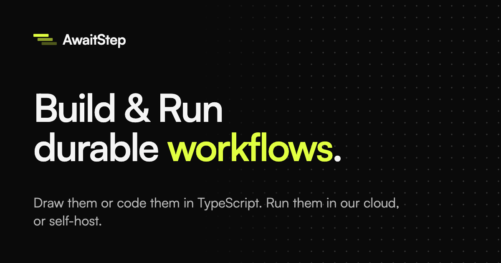
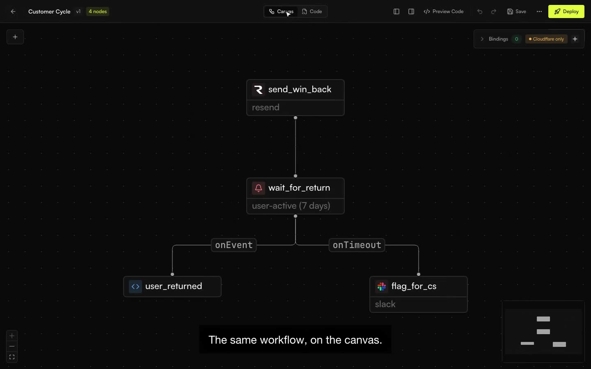
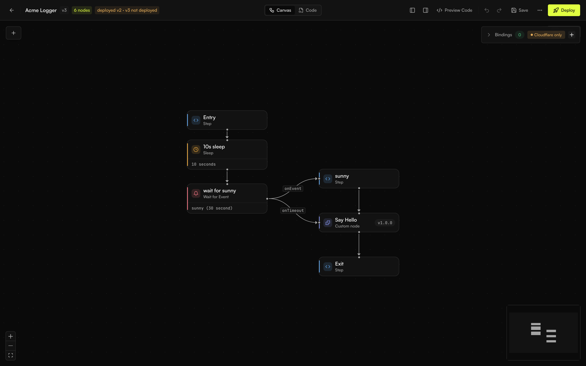
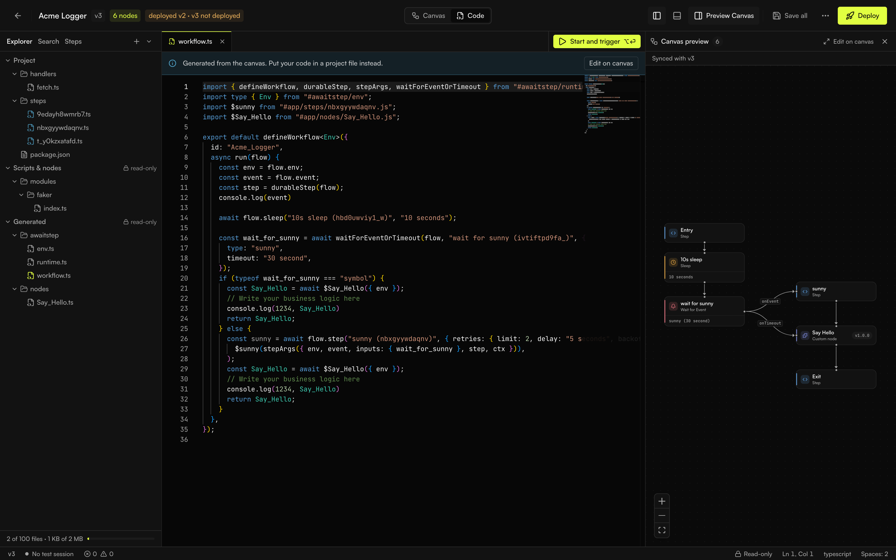
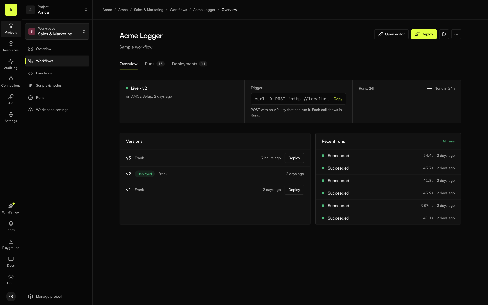
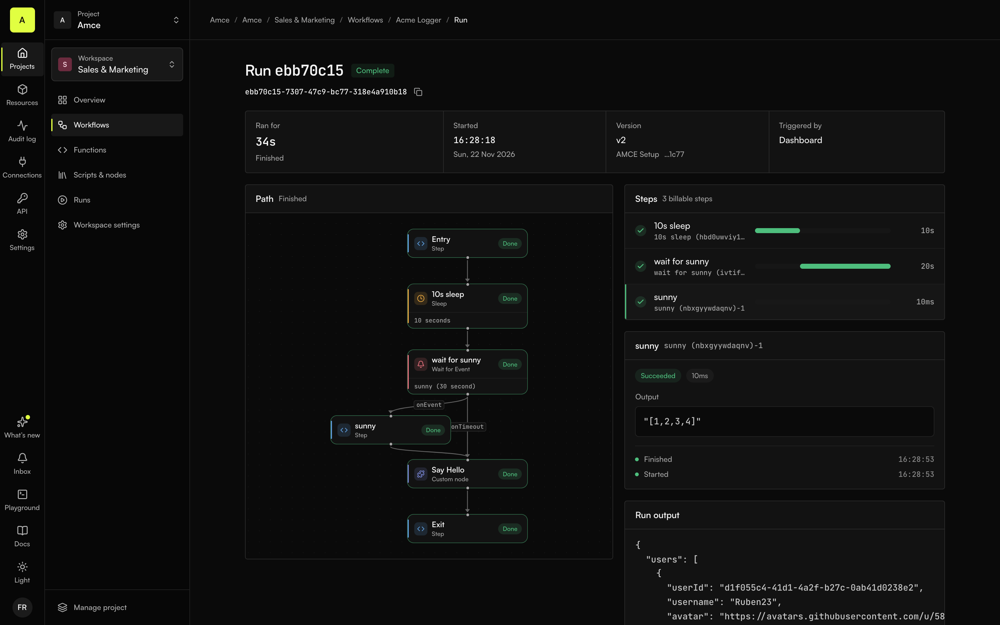

<div align="center">



Draw them on a canvas or write them in TypeScript. AwaitStep retries what fails, shows every step, and deploys the code it generates — code you can read in full.
Use AwaitStep Cloud, or self-host the open-source edition.

[](LICENSE)
[](https://docs.awaitstep.dev/installation/cloudflare-workers)

[Website](https://awaitstep.dev) &bull; [AwaitStep Cloud](https://app.awaitstep.dev) &bull; [Self-host](https://docs.awaitstep.dev/installation/docker-compose) &bull; [Documentation](https://docs.awaitstep.dev) &bull; [REST API](https://docs.awaitstep.dev/api/rest)

</div>

---

## Demo

<a href="https://awaitstep.dev/video/demo.mp4">
  
</a>

<p align="center"><sub>▶ <a href="https://awaitstep.dev/video/demo.mp4">Watch AwaitStep in one minute</a> — open a project, a workflow and its code, switch to the canvas, deploy, and follow a run.</sub></p>

---

<table>
<tr>
<td width="40%" valign="top">

### Build on the canvas

Steps, branches, loops, parallel paths, races, try / catch, sleeps and waits for events — drawn as a graph. Join nodes from any side, and add the next node straight from a `+`.

- 13 built-in nodes, plus 45 integrations ready to drop in
- Custom nodes and reusable scripts from your Library
- Start from a template, or import a workflow

</td>
<td width="60%">



</td>
</tr>
</table>

---

<table>
<tr>
<td width="60%">



</td>
<td width="40%" valign="top">

### Drop into code anytime

Canvas and Code edit the same workflow. Each step is a TypeScript module in your project, with a typed editor, search across files, and changes you review before you save.

- The generated `workflow.ts` is readable, and yours
- The canvas preview follows every edit
- Run one step, or the whole workflow in a test session

</td>
</tr>
</table>

---

<table>
<tr>
<td width="40%" valign="top">

### Ship it, see what's live

Every deploy is a version. See which version runs on each account, roll back (it asks first), and take one account down on its own.

- A trigger URL to start runs with an API key
- Version history and per-account deployments
- Recent runs at a glance

</td>
<td width="60%">



</td>
</tr>
</table>

---

<table>
<tr>
<td width="60%">



</td>
<td width="40%" valign="top">

### Watch every run

Each run has its own page: the path it took, every step with its attempts and timing, its output, and the version that ran. Failed runs land in your inbox.

- Live step-by-step progress
- Step and run output
- Pause, resume and terminate

</td>
</tr>
</table>

---

### Workflows and Functions

|                 | **Workflows**                                                                                                       | **Functions**                                                             |
| --------------- | ------------------------------------------------------------------------------------------------------------------- | ------------------------------------------------------------------------- |
| What it is      | Background work that survives restarts and picks up where it stopped                                                | A request in, a response out                                              |
| What you get    | Retries with backoff, sleeps up to a year, waits for events with a timeout path, parallel paths, races, try / catch | Your own routes, steps that retry inside a request, a response you choose |
| How you call it | A trigger URL, the REST API, or another workflow                                                                    | Its own URL, with an API key                                              |

### Building blocks

| Node             | What it does                                     | Node               | What it does                              |
| ---------------- | ------------------------------------------------ | ------------------ | ----------------------------------------- |
| **Step**         | Run your code with retries and backoff           | **Parallel**       | Run paths at the same time                |
| **Branch**       | Take a path based on a condition                 | **Race**           | Keep the first path that finishes         |
| **Loop**         | Repeat steps (forEach, while, or count)          | **Break**          | Leave a loop early                        |
| **Try / Catch**  | Handle errors with try / catch / finally         | **Sleep**          | Pause for a duration (up to a year)       |
| **Sleep Until**  | Pause until a timestamp                          | **Wait for Event** | Pause until an event arrives, or time out |
| **HTTP Request** | Call an API with retries                         | **Sub-Workflow**   | Start another workflow                    |
| **Custom**       | Your own nodes and integrations from the Library |                    |                                           |

### Built for teams, and their agents

- **Orgs, projects, workspaces** — admin, editor and viewer roles, invites and an audit log.
- **API keys scoped to the work** — one workspace or several; start runs from your own systems. Try every endpoint in the built-in API playground.
- **Your coding agent** — install the skill pack, give it a project key, and describe the job.

AwaitStep ships an [Agent Skills](https://docs.awaitstep.dev/agents/) pack that teaches Claude Code, Cursor, Codex and other coding agents to build workflows, Functions, Library modules and custom nodes through the API, and to work safely in Canvas or Code mode.

```bash
npx skills add awaitstep/awaitstep
```

Or install it in Claude Code from the plugin marketplace:

```text
/plugin marketplace add awaitstep/awaitstep
/plugin install awaitstep@awaitstep
```

---

## Cloud or self-hosted

|                    | **AwaitStep Cloud**                                              | **Self-hosted**                            |
| ------------------ | ---------------------------------------------------------------- | ------------------------------------------ |
| Setup              | Nothing to install — [start building](https://app.awaitstep.dev) | Docker, Node, or Cloudflare Workers        |
| Where runs execute | On AwaitStep, or bring your own Cloudflare account               | Your Cloudflare account, on its plan       |
| Database           | Managed                                                          | SQLite or Postgres (D1 on Cloudflare)      |
| License            | —                                                                | AGPL-3.0; your data stays in your database |

Workflows deploy to Cloudflare today; more providers are on the way.

[](https://docs.awaitstep.dev/installation/cloudflare-workers)

## Quickstart (from source)

**Prerequisites:** Node.js >= 22.23.4, pnpm >= 12

```bash
git clone https://github.com/awaitstep/awaitstep.git
cd awaitstep
cp .env.example .env
```

Generate the required secrets and update `.env`:

```bash
openssl rand -hex 32     # TOKEN_ENCRYPTION_KEY
openssl rand -base64 32  # BETTER_AUTH_SECRET
```

Then build and start:

```bash
pnpm install
pnpm build
pnpm dev
```

For Docker Compose, a VPS or Cloudflare Workers, see the [installation guides](https://docs.awaitstep.dev/installation/docker-compose).

## Documentation

- [Quickstart](https://docs.awaitstep.dev/getting-started/quickstart) — Build and deploy your first workflow
- [Architecture](docs/architecture.md) — System design, data flow, and package structure
- [API Reference](docs/api-reference.md) — All endpoints and database schema
- [Compilation Pipeline](docs/compilation.md) — How canvas IR becomes deployed code
- [Custom Nodes](docs/custom-nodes.md) — Build and publish your own node types

**Built with** TypeScript &bull; React &bull; Hono &bull; Cloudflare Workers

## Security

To report a security vulnerability, see [SECURITY.md](SECURITY.md).

## AI Usage

This project uses AI tools during development. See [AI_USE.md](AI_USE.md) for details.

## Contributing

See [CONTRIBUTING.md](CONTRIBUTING.md) for setup instructions and guidelines.

## License

AwaitStep is licensed under the [GNU Affero General Public License v3.0](LICENSE) (AGPL-3.0-only). Copyright 2026 AwaitStep.

The parts that end up inside your own deployed code are licensed under the [Apache License 2.0](packages/sdk/LICENSE) instead: `packages/sdk` (its runtime is copied into every deployed Worker), `packages/templates`, the node registry in `registry/`, and the agent skills in `skills/`. The packages and the registry carry their own `LICENSE` file; each skill declares `license: Apache-2.0` in its `SKILL.md`.

**Your generated code is yours.** Additional permission under GNU AGPL version 3 section 7: the code AwaitStep generates for your workflows and Functions, and the project files it writes for you, may be used, modified, deployed and distributed under terms of your choosing, even where they contain portions of AwaitStep's source. This permission covers that output only, not AwaitStep itself.

Versions 1.4.14 and earlier were released under Apache 2.0, and those releases stay under it.
